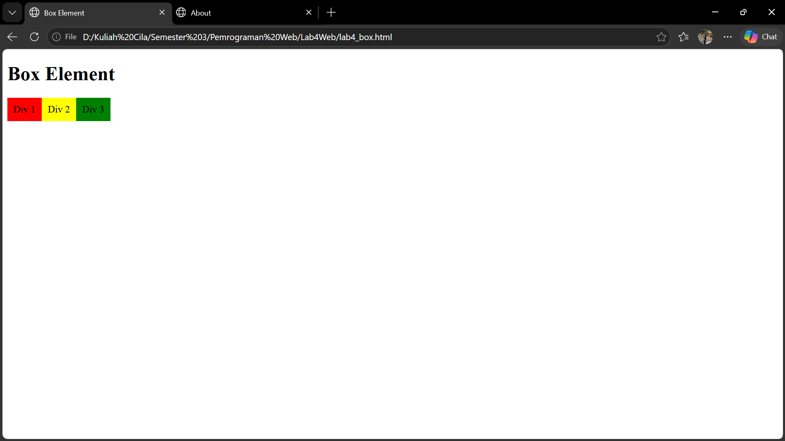
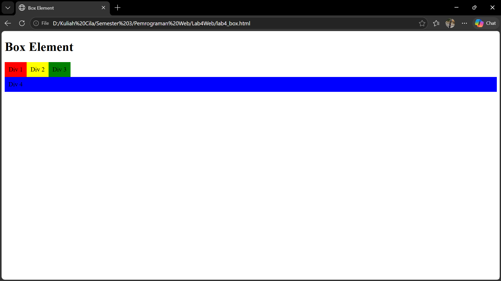

# Praktikum 4: Box Element dan CSS Float

**Nama:** Naysila Rahil Maulana
**NIM:** 312510143
**Mata Kuliah:** Pemrograman Web

Pada bagian ini saya mempelajari konsep box element, CSS float, dan clearfix
menggunakan file `lab4_box.html`.

## 1. Membuat Dokumen HTML

Saya membuat file `lab4_box.html` berisi struktur dasar HTML dengan elemen
`<header>` yang memuat judul `<h1>Box Element</h1>`.

## 2. Membuat Box Element

Di dalam `<section>` saya membuat `<div>` dengan class `div1`, `div2`, dan
`div3` sebagai box. Tanpa float, ketiganya tersusun ke bawah (satu div satu
baris). Kemudian pada tahap clearfix saya menambahkan `div4`.

## 3. CSS Float Property

Saya menambahkan CSS di dalam tag `<style>` pada bagian `<head>`. Semua `div`
diberi `float: left` dan `padding: 10px`, lalu tiap div diberi warna latar
berbeda (merah, kuning, hijau). Dengan `float: left`, ketiga div berjajar ke
samping dan lebarnya menyesuaikan isi.

```css
div {
  float: left;
  padding: 10px;
}
```



## 4. Clearfix

Saya menambahkan `div4` setelah `div3`. Karena semua div di-float, `div4`
awalnya ikut berjajar. Saya memberi `div4` properti `clear: left` dan
`float: none` supaya turun ke baris baru di bawah elemen float.

```css
.div4 {
  background-color: blue;
  clear: left;
  float: none;
}
```



## 5. Eksperimen Nilai `clear`

Saya mencoba mengganti nilai `clear` pada `.div4` dengan nilai lain.

| Nilai clear | Hasil yang saya amati |
|---|---|
| `left` | Div 4 turun ke baris baru di bawah ketiga div. |
| `both` | Hasilnya sama dengan `left`, Div 4 turun ke baris baru. |
| `right` | Div 4 tidak turun. Latar biru memanjang di belakang div1 sampai div3, dan tulisan "Div 4" tampil di sebelah kanan Div 3. |

Perbedaannya terjadi karena semua div lain di-float ke kiri. `clear: left`
dan `clear: both` menghindari elemen float kiri, sedangkan `clear: right`
hanya menghindari elemen float kanan, padahal tidak ada elemen float kanan.

## Kesimpulan

Property `float` membuat elemen mengambang ke kiri atau kanan sehingga
beberapa elemen bisa berjajar ke samping. Property `clear` dipakai untuk
mengatur elemen setelah float agar turun ke baris baru dan tidak ikut
berjajar.