# Praktikum 4: Layout Web Sederhana

**Nama:** Naysila Rahil Maulana
**NIM:** 312510143
**Mata Kuliah:** Pemrograman Web

Pada praktikum ini saya membuat layout web sederhana menggunakan HTML5
semantic element dan CSS float. Semua file ada di folder `lab4_layout`.

## 1. Kerangka HTML dengan Semantic Element

Saya membuat file `home.html` dan `style.css`. Di dalam `<div id="container">`
saya menyusun kerangka layout dengan elemen `<header>`, `<nav>`,
`<section id="hero">`, `<section id="wrapper">` (berisi `<section id="main">`
dan `<aside id="sidebar">`), serta `<footer>`. Pada tahap ini halaman masih
polos karena belum ada CSS.

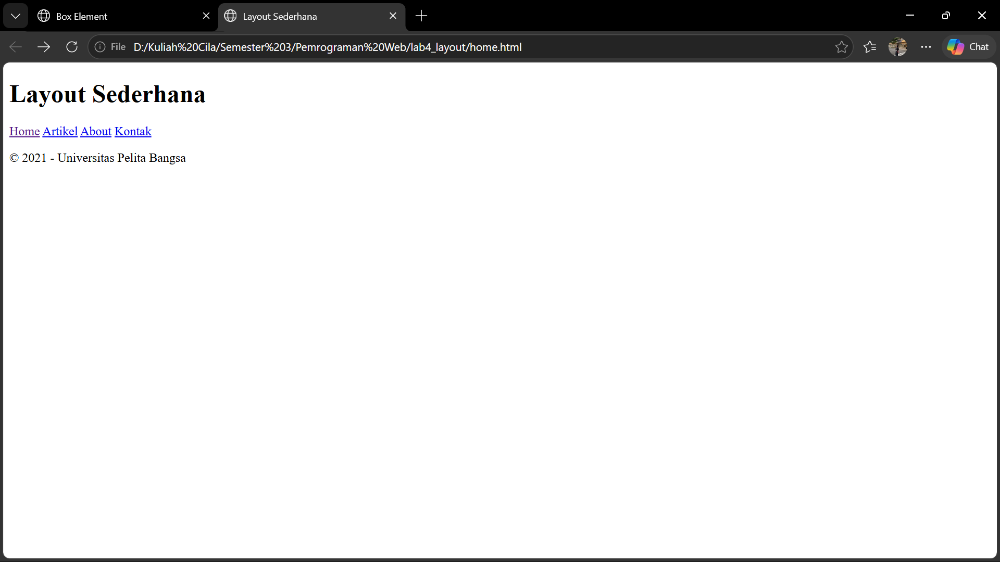

## 2. CSS Dasar, Container, dan Header

Saya menambahkan Google Font Open Sans dan reset CSS (`margin: 0; padding: 0`)
agar tampilan konsisten di semua browser. `#container` diberi lebar 980px dan
`margin: 0 auto` supaya berada di tengah halaman, serta `box-shadow` untuk
bayangan tipis. Header diberi padding dan judul berwarna abu-abu.

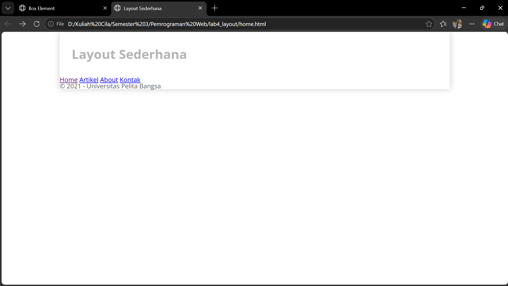

## 3. Navigasi

Elemen `<nav>` diberi warna latar biru. Link `<a>` dibuat `inline-block`
dengan padding supaya berjajar ke samping dan area kliknya lebih luas.
Efek `nav a:hover` dan class `active` membuat menu yang aktif atau
di-hover berwarna lebih terang.

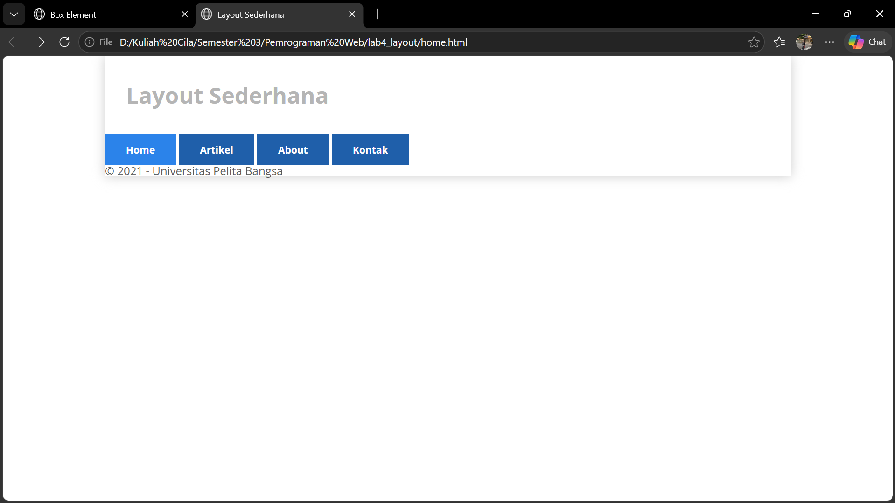

## 4. Hero Panel

Hero panel adalah area besar di bawah menu yang berisi judul "Hello World!",
paragraf pengantar, dan link "Learn more". Saya mengaturnya dengan
`#hero` (warna latar abu-abu, padding, margin bawah), `#hero h1`, dan `#hero p`.

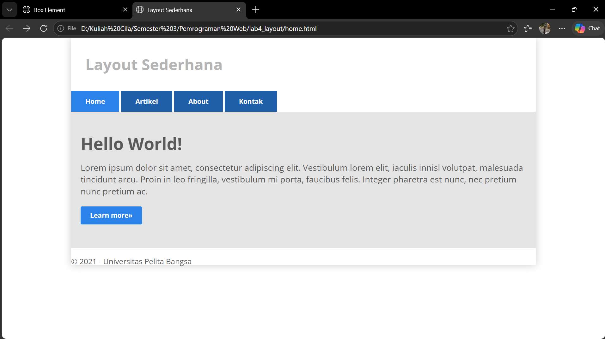

## 5. Main Content dan Sidebar dengan CSS Float

`#main` (lebar 640px) dan `#sidebar` (lebar 260px) sama-sama diberi
`float: left` sehingga tampil berdampingan. Total lebarnya 980px (termasuk
padding 20px di tiap sisi), sama dengan lebar container.

```css
#main    { float: left; width: 640px; padding: 20px; }
#sidebar { float: left; width: 260px; padding: 20px; }
```

## 6. Sidebar Widget

Di dalam `<aside id="sidebar">` saya menambahkan dua `div.widget-box`:
satu berisi daftar link (`<ul>`) dan satu berisi teks. Judul widget diberi
latar biru, list dibuat tanpa bullet, dan efek hover pada link.

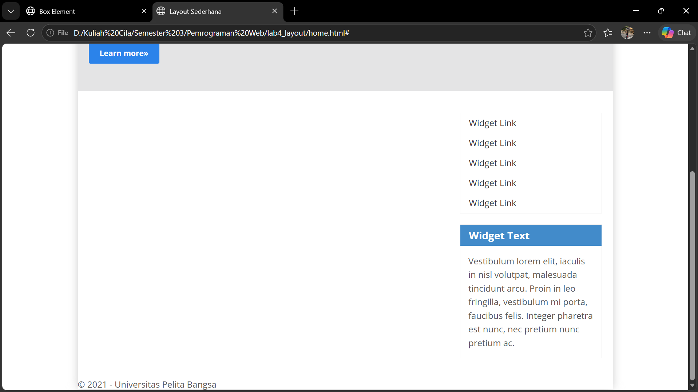

## 7. Footer

Footer diberi `clear: both` agar turun ke bawah setelah elemen float
(main dan sidebar). Tanpa `clear`, footer akan naik dan tertimpa elemen
yang mengambang.

```css
footer { clear: both; background-color: #1d1d1d; padding: 20px; color: #eee; }
```

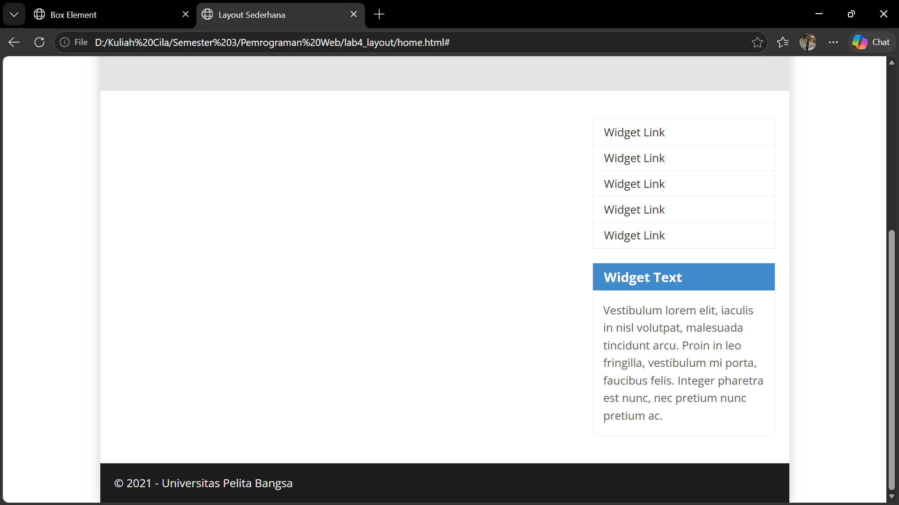

## 8. Box Content (Tiga Kolom)

Di dalam `<section id="main">` saya membuat `div.row` berisi tiga `div.box`.
Setiap box diberi `float: left` dan `width: 33.333333%` sehingga menjadi tiga
kolom. Gambar dibuat bulat dengan `border-radius: 50%` (class `image-circle`).
Agar `div.row` tetap membungkus elemen float di dalamnya, saya memakai
teknik clearfix (`.row:after` dengan `clear: both`).

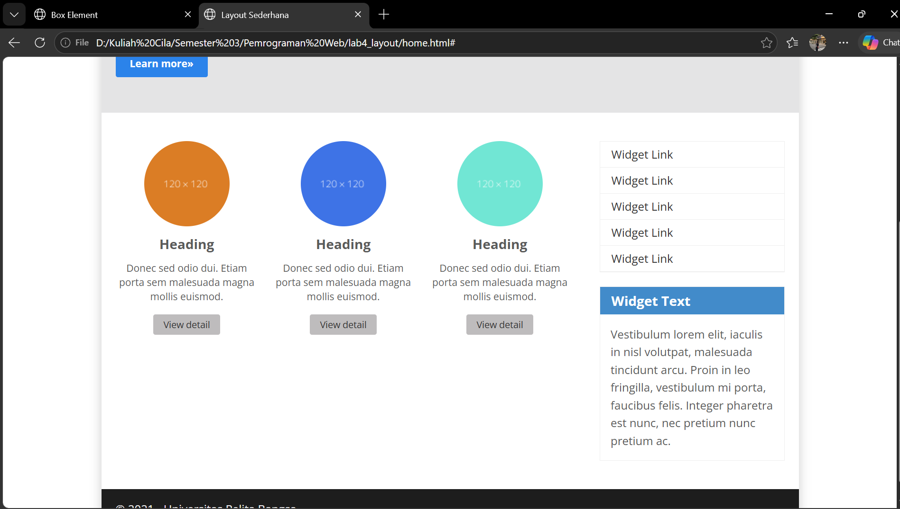

## 9. Content Artikel

Saya menambahkan dua `<article class="entry">` yang dipisahkan garis
`<hr class="divider">`. Gambar pada artikel pertama di kiri (`float: left`),
sedangkan pada artikel kedua di kanan memakai class `right-img`
(`float: right`).

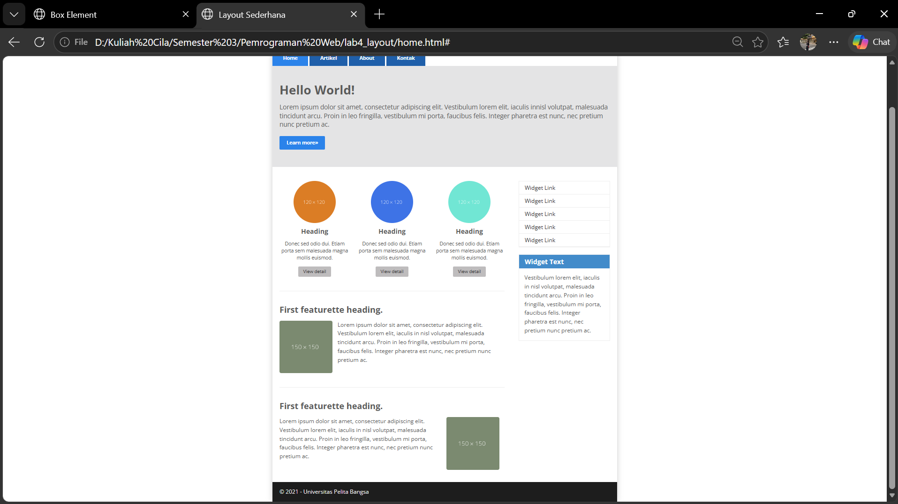

## 10. Validasi HTML

Saya memvalidasi `home.html` di validator.w3.org. Sempat muncul error karena
tingkat judul melompat dari `<h1>` ke `<h3>` pada box. Saya memperbaikinya
dengan mengganti `<h3>` menjadi `<h2>` dan menyesuaikan CSS-nya (`.box h2`).

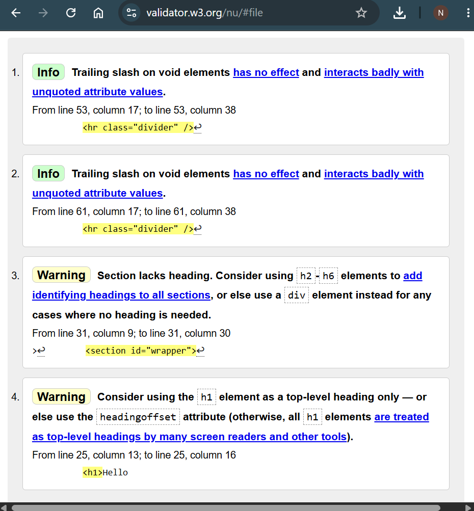

## Tugas 1: Halaman About (`about.html`)

Halaman about berisi tentang saya dan web latihan yang pernah saya buat.
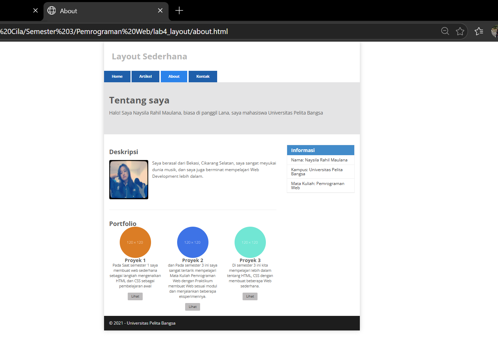

## Tugas 2: Halaman Contact (`kontak.html`)

Disini saya membuat form sederhana.

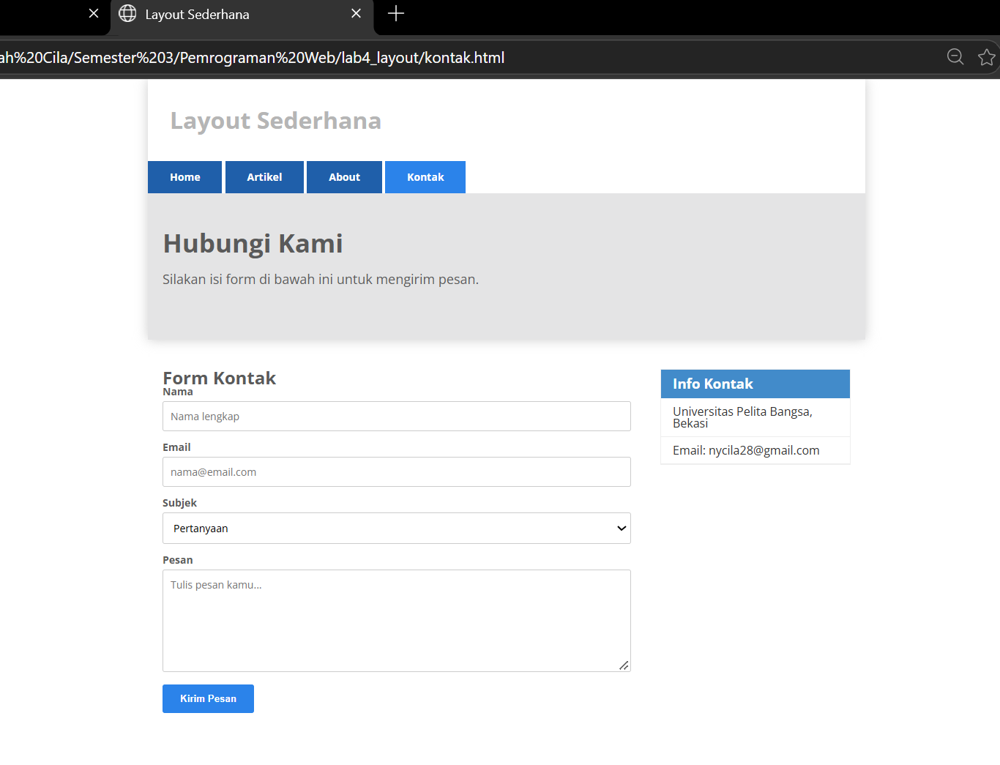